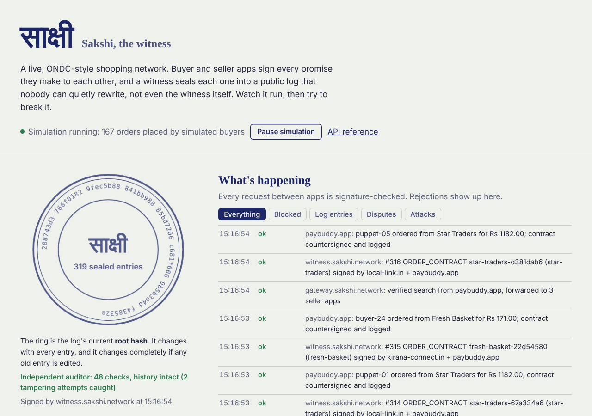
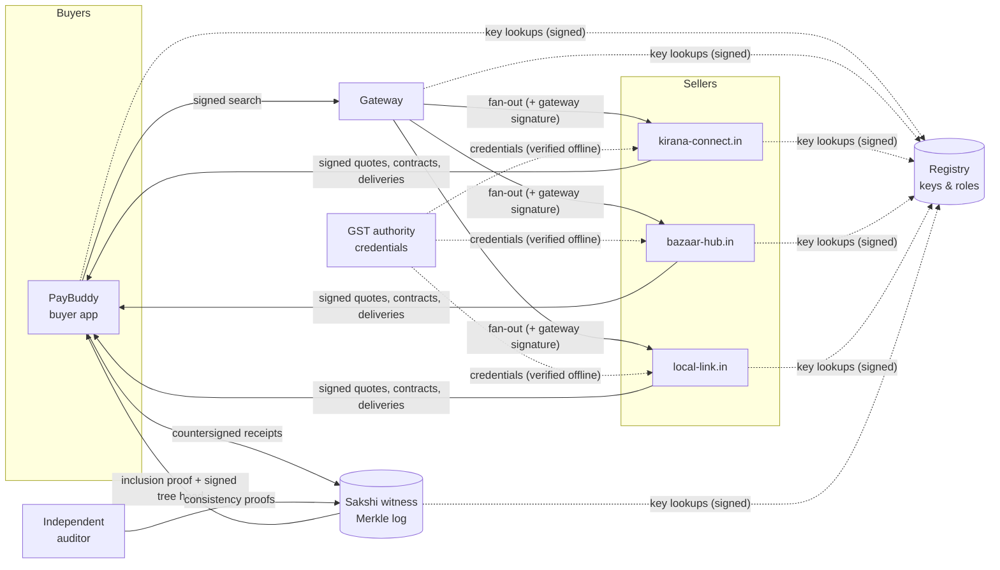

# Sakshi (साक्षी): a trust layer for open commerce networks

[](../../actions/workflows/ci.yml)


*Sakshi* means "witness". It is a research prototype that adds **verifiable trust** to open commerce networks
like India's ONDC. Buyer and seller apps sign every promise they make to each other, and a witness seals those
promises into a tamper-evident Merkle log. Disputes are settled from evidence, reputation is recomputable by
anyone, and fake-review rings are detected from the trade graph.

**Live demo:** [add your deployed link here](https://sakshi-demo.onrender.com). Watch a simulated network trade, then run 17 real attacks
against it.



---

## The problem

ONDC lets independent buyer apps, seller apps and logistics providers trade with each other without a central
platform. Its biggest obstacle is **trust between parties who have never met**: who is accountable when an
order goes wrong, can a seller's rating be believed, and is the seller even who they claim to be?

ONDC's protocol (Beckn) already signs every message with Ed25519, which proves **who sent a message**. It
does not leave either side holding **portable proof of what was agreed**:

* each app keeps its own logs, so a dispute is one database against another,
* seller ratings are self-reported stars, easy to inflate with fake orders,
* a "GST verified" badge is just a field in a catalogue.

## What Sakshi adds

| Trust gap | Sakshi's mechanism | Code |
|---|---|---|
| Is this request genuine and untouched? | ONDC-format request signing (Ed25519 over BLAKE2b-512), plus replay protection, clock-skew limits, sender-spoofing and role checks | [`auth.py`](src/sakshi/auth.py), [`replay.py`](src/sakshi/replay.py) |
| Can a participant be impersonated? | Registry onboarding with an X25519 + AES-GCM challenge, operator approval, key rotation that must be authorised by the current key, revocation, and signed lookup responses | [`registry.py`](src/sakshi_network/registry.py) |
| "I never promised that" | **Receipts:** every quote, contract, delivery and cancellation is signed by the issuer and countersigned by the counterparty (non-repudiation) | [`receipts.py`](src/sakshi/receipts.py) |
| Can the records be edited later? | **Transparency log:** an RFC 6962 Merkle tree with signed tree heads, inclusion and consistency proofs, and an independent auditor | [`merkle.py`](src/sakshi/merkle.py), [`ledger.py`](src/sakshi_network/ledger.py) |
| Disputes take weeks | **Evidence-based verdicts** for factual claims (not delivered, late, price changed), each citing its evidence and logged. Subjective claims go to humans | [`disputes.py`](src/sakshi/disputes.py) |
| Ratings can be faked | **Verifiable reputation:** a deterministic function of the log; anyone can recompute it from a signed tree head | [`reputation.py`](src/sakshi/reputation.py) |
| Sellers boost themselves with sock puppets | **Collusion detection:** buyer-seller graph analysis plus an IsolationForest on trade behaviour | [`fraud.py`](src/sakshi/fraud.py) |
| Fake "verified" badges | **Verifiable credentials** signed by an issuer (a mock GST authority with real GSTIN checksum validation), plus a signed revocation list | [`credentials.py`](src/sakshi/credentials.py) |

The core is a small **Python library** (`pip install sakshi`), plus a **zero-dependency Java SDK** that is
wire-compatible with it, and a runnable **demo network** built on both.

## How it works



**One order, start to finish:**

```mermaid
sequenceDiagram
    participant Buyer as Buyer app
    participant Seller as Seller app
    participant W as Witness log
    Buyer->>Seller: select (signed request)
    Seller-->>Buyer: on_select + QUOTE signed by seller
    Buyer->>Seller: confirm (signed request)
    Seller-->>Buyer: on_confirm + CONTRACT signed by seller
    Note over Buyer: Same terms as the quote?<br/>No: refuse and file PRICE_MISMATCH<br/>using the seller's own signatures
    Buyer->>W: CONTRACT countersigned by buyer app
    W-->>Buyer: entry #n, inclusion proof, signed root
    Seller-->>Buyer: on_status + FULFILMENT signed by seller
    Buyer->>W: FULFILMENT countersigned
    Note over Buyer,W: Missed the promised time? The buyer app files a dispute;<br/>the witness decides from logged evidence and logs the verdict
```

Every hop is verified: signature, digest, freshness, replay, "is the signer who the message claims to be",
and "is the signer allowed in that role".

## Attack lab

The dashboard has a button for each attack. Each one sends **real requests** to the running services (or
really tampers with the log), and reports what the defending code did. The same attacks run in the test suite.

| Attack | The attacker tries to... | Stopped by | Result |
|---|---|---|---|
| Forged signature | send requests as PayBuddy without its private key | Ed25519 verification with the key from the registry | `AUTH_BAD_SIGNATURE` |
| Tampered request | change quantity 1 → 50 in transit | BLAKE2b-512 body digest inside the signature | `AUTH_BAD_SIGNATURE` |
| Replay | resend a captured valid request | signature cache until expiry (Redis `SET NX` across replicas) | `AUTH_REPLAY` |
| Expired signature | reuse a 10-minute-old capture | `created`/`expires` window with skew tolerance | `AUTH_EXPIRED` |
| Sender spoofing | sign with its own valid key while claiming to be another app | signer must equal `context.bap_id`/`bpp_id` | `AUTH_SPOOFED_SENDER` |
| Gateway bypass | pose as the gateway to reach sellers directly | the gateway signature's owner must have role `BG` | `AUTH_WRONG_ROLE` |
| Leaked key | use a key that leaked and was revoked | rotation authorised by the old key, then revocation | `AUTH_KEY_REVOKED` |
| Fake registry answer | hand out its own key in a lookup response | lookups signed by a **pinned** registry key | `AUTH_BAD_SIGNATURE` |
| Registration hijack | register a new key for an existing participant | new keys must be co-signed by a current key | `SUBSCRIBE_ROTATION_UNAUTHORISED` |
| Unapproved participant | join without operator approval | approved-participant list with exact URLs | `SUBSCRIBE_NOT_APPROVED` |
| Forged GST credential | self-sign a "verified" badge | credential signature checked against the issuer's key | `CRED_BAD_SIGNATURE` |
| Bait and switch | quote low, confirm high | buyer app compares the two signed documents | `PRICE_MISMATCH` (buyer wins) |
| Seller denies a promise | deny a delivery promise | countersigned contract + inclusion proof | denial disproven |
| Backdated receipt | two colluders log a receipt dated 3 days ago | witness only accepts fresh receipts; log position is the timestamp | `LEDGER_STALE` |
| Silent ledger edit | the log operator edits an old entry | inclusion proof against the signed root | detected |
| History rewrite | the operator edits **and** rebuilds the whole tree | auditor's consistency proof from its saved tree head | detected |
| Fake-review boosting | inflate a seller's score with sock-puppet orders | captive-buyer graph + behaviour anomaly | flagged for review |


## Results

### Performance (one CPU core, Python 3.13)

| Operation | Measured |
|---|---|
| Verify a signed request (digest + Ed25519 + replay check) | **~7,100 / s**, p50 0.14 ms, p99 0.17 ms |
| Sign a request | ~13,000 / s |
| Verify a countersigned receipt (2 signatures) | ~3,400 / s |
| Append to the Merkle log | ~1.47 M entries / s |
| Inclusion proof in a log of **1,000,000** entries | 20 hashes (640 bytes); generated in 0.04 ms, verified in 0.017 ms |

Reproduce with `python benchmarks/perf_benchmark.py` (raw numbers in
[`benchmarks/perf_results.json`](benchmarks/perf_results.json)).

### Collusion detection (synthetic marketplace)

There is no public labelled ONDC fraud dataset, so [`benchmarks/fraud_benchmark.py`](benchmarks/fraud_benchmark.py)
simulates a month of trade with known ground truth: about 200 sellers and 20,000 orders per run. Thresholds
were tuned on seed 0 only; the results below are from **10 unseen seeds**.

| Population | Flagged |
|---|---|
| Sock-puppet sellers | 80 / 80 |
| Collusion rings (2–3 sellers sharing fake buyers) | 74 / 74 |
| Camouflaged puppets (also order from honest sellers) | 50 / 50 |
| Honest sellers | **0 / 1,584** |
| Honest *local shops with loyal regulars* (the hard negatives) | **0 / 120** |
| New sellers | 0 / 77 |
| **Adaptive attacker** (fakes realistic delivery times and prices) | 4 / 40: *mostly missed* |

Precision 1.00 and recall 1.00 on the modelled attacks. Treat that honestly: the attacks are synthetic and
the model was designed with them in mind. The **adaptive attacker** row is the real lesson. Once fake orders
look physically real, only the graph signal is left, and that alone would also flag honest local shops. That
is why flags go to human review instead of changing scores automatically.


## Run it

**Option 1: Python (simplest)**

```bash
pip install -e ".[network]"
uvicorn sakshi_network.app:create_app --factory --port 8000
# open http://localhost:8000
```

**Option 2: Docker, single container** (what the live demo runs)

```bash
docker build -t sakshi .
docker run -p 8000:8000 sakshi
```

**Option 3: fully distributed** (9 services + Redis, real network between them)

```bash
docker compose up --build          # or, without Docker: ./scripts/run_distributed.sh
```

API docs: http://localhost:8000/docs

### Deploy the live demo (free)

The repo includes a [`render.yaml`](render.yaml) blueprint. On [Render](https://render.com): **New → Blueprint →
select this repository**. The simulation pauses itself after 10 minutes without viewers, so it fits the free tier.

## Use the library

**Python: sign and verify ONDC-style requests**

```python
from sakshi.auth import create_authorization_header, verify_authorization
from sakshi.client import RegistryResolver
from sakshi.replay import MemoryReplayStore

header = create_authorization_header(body, "mybuyer.app", "k1", signing_private_key)

# receiving side: keys come from the registry (responses verified against its pinned key)
sender = await verify_authorization(header, body, registry_resolver, replay=MemoryReplayStore())
```

**Python: a non-repudiable receipt**

```python
from sakshi.receipts import new_receipt, verify_receipt

receipt = new_receipt("ORDER_CONTRACT", issuer="seller.app", counterparty="buyer.app",
                      transaction_id=txn, order_id=oid, seller_id="shop-1", buyer_ref=ref,
                      terms={"price": {"currency": "INR", "value": "499.00"}, "promised_delivery_by": t})
receipt.sign_as_issuer("k1", seller_key)        # seller commits
receipt.countersign("k1", buyer_key)            # buyer acknowledges
await verify_receipt(receipt, resolver)         # anyone can check, forever
```

**Java SDK** (no runtime dependencies, Java 17+)

```java
String header = AuthHeader.create(body, "mybuyer.app", "k1", privateKeyBase64);
AuthHeader.Sender sender = AuthHeader.verify(header, body, registry::lookup);
boolean included = Merkle.verifyInclusion(leafHash, index, treeSize, proof, signedHead.root());
```

The Java and Python implementations are tested against shared vectors
([`scripts/make_test_vectors.py`](scripts/make_test_vectors.py)). Ed25519 is deterministic, so both must
produce **byte-identical** headers.

## Design decisions

* **Ed25519 + BLAKE2b-512**: what ONDC/Beckn already specify, so Sakshi fits existing participants. Ed25519 is
  fast, has small keys, and its deterministic signatures make cross-language testing exact.
* **AES-GCM instead of ONDC's AES-ECB** for the onboarding challenge. ECB leaks patterns and has no
  integrity check; GCM is authenticated encryption, and the subscriber id is bound in as associated data.
* **A Merkle log, not a blockchain.** The goal is tamper-*evidence*, not leaderless consensus. A signed
  Merkle log (the design behind Certificate Transparency) gives kilobyte proofs and microsecond verification
  with no mining or tokens. Independent auditors stop the operator from forking history.
* **Signatures are domain-separated.** Each kind of signature (request, receipt, countersignature, tree head,
  credential) has its own prefix, so a signature made for one purpose can't be replayed as another.
* **Canonical JSON forbids floats.** Money is a decimal string and time is integer seconds, so every language
  serialises a signed object to exactly the same bytes.
* **Buyer privacy.** The public log only holds an HMAC pseudonym per buyer. It is linkable for fraud analysis
  but can't be reversed by guessing phone numbers.
* **Flags are not penalties.** Fraud detection sends sellers to human review. Scores change only through
  signed evidence.

## Limitations

* This is a research prototype on simulated participants, not an integration with the live ONDC network
  (that needs official onboarding).
* Demo keys are derived from a seed so containers agree without a key-exchange step. Real participants would
  generate keys privately, ideally in an HSM or KMS.
* The witness is a single log. Production would add multiple witnesses and gossip of tree heads between
  auditors.
* Receipts prove what parties *signed*. A buyer app could still lie about a delivery it never received. That
  needs a delivery-time signal such as an OTP handed to the delivery agent.
* Collusion detection is evaluated on synthetic data and is evadable by an adaptive attacker (see Results).

## Project structure

```
src/sakshi/              the library
  auth.py                  ONDC-format request signing & verification
  crypto.py                Ed25519, X25519, AES-GCM, BLAKE2b
  receipts.py              signed + countersigned commitments
  merkle.py                RFC 6962 tree, inclusion/consistency proofs, signed tree heads
  reputation.py            verifiable reputation from the log
  disputes.py              evidence-based dispute decisions
  fraud.py                 collusion detection (networkx + scikit-learn)
  credentials.py           verifiable seller credentials
src/sakshi_network/      the runnable network
  registry.py gateway.py bap.py bpp.py ledger.py issuer.py
  attacks.py               the 17-attack lab
  console.py static/       the live dashboard
java/                    Java SDK (BLAKE2b, Ed25519 headers, Merkle verification)
benchmarks/              performance and fraud benchmarks (+ results)
tests/                   95 Python tests: unit, property-style and end-to-end network tests
```

## Tests

```bash
pip install -e ".[dev]" && pytest          # 95 tests, about 7 s
cd java && mvn test                        # 10 tests, incl. cross-language vectors
```

CI runs both, plus lint, a check that the test vectors are up to date, and the Docker build.

## License

MIT
